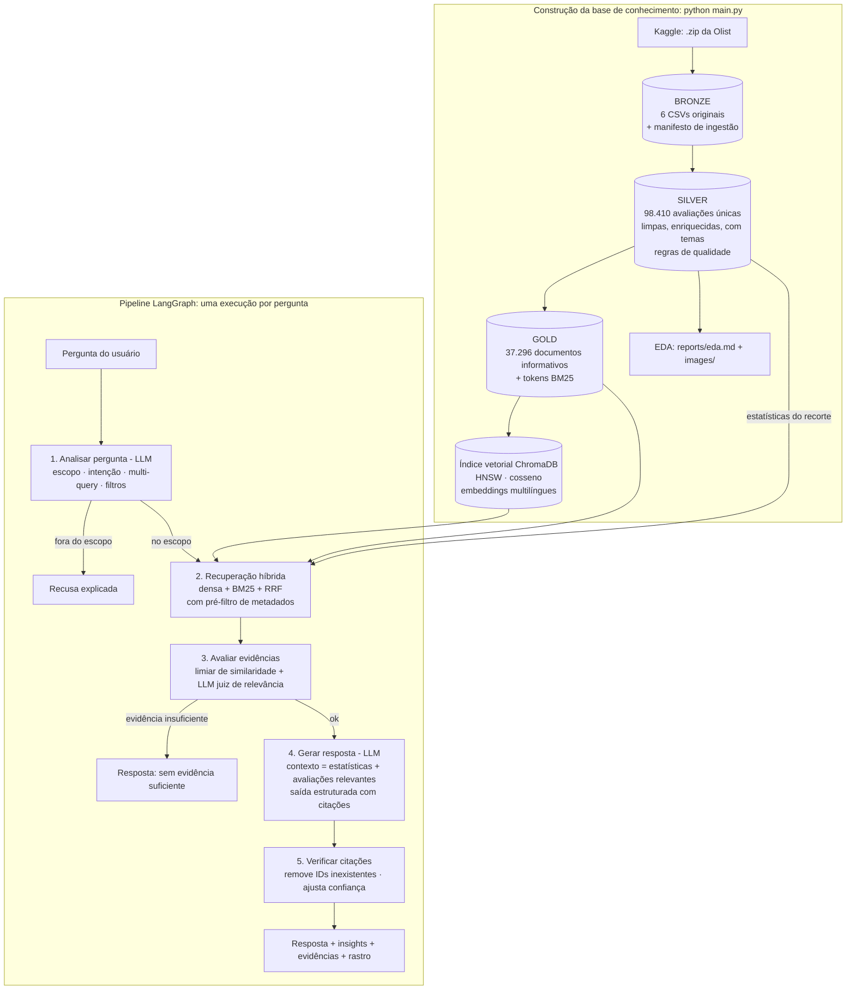
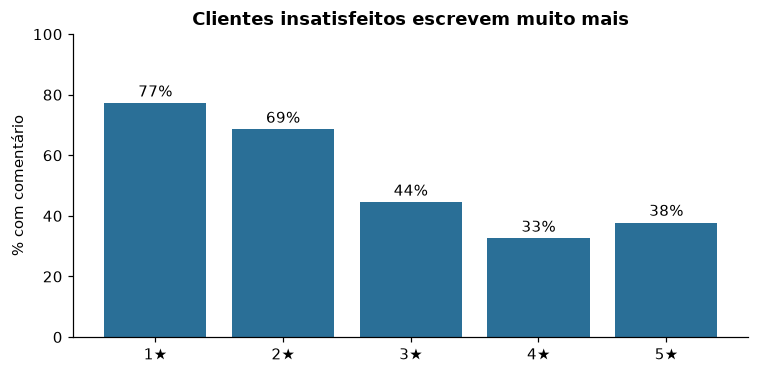
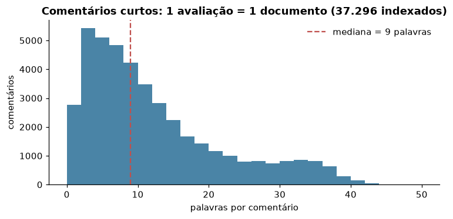
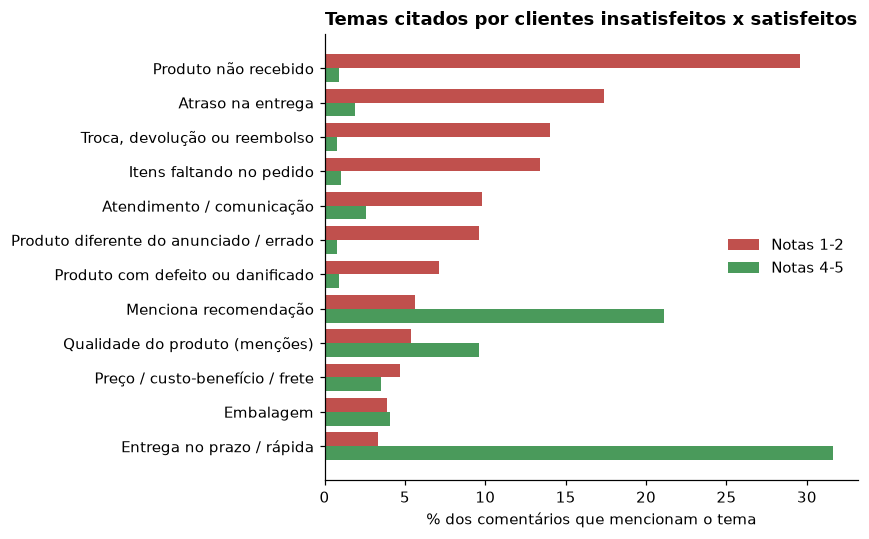
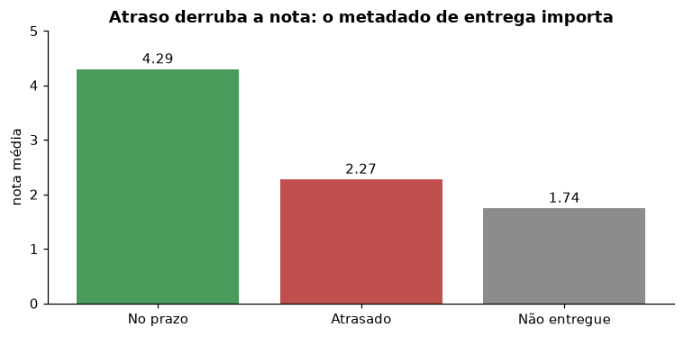
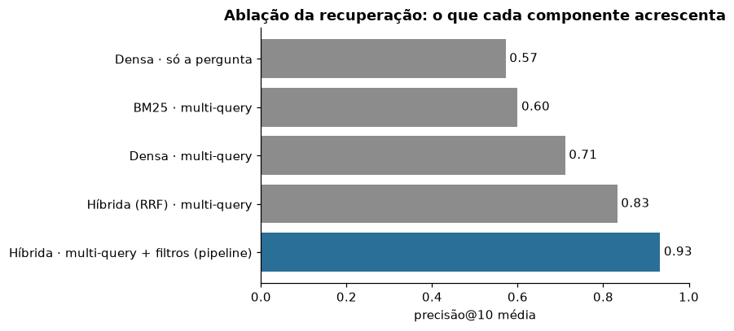

# Voice of Customer Intelligence com RAG

> Tech Challenge — Fase 4 | RAG sobre as avaliações de clientes do *Brazilian E-Commerce Public Dataset by Olist*

Gestores e analistas fazem perguntas em linguagem natural ("quais são os principais problemas de entrega?") e recebem respostas **fundamentadas em avaliações reais**. Cada insight aponta as avaliações que o sustentam. Quando a base não tem evidência suficiente, ou a pergunta está fora do escopo, o sistema **recusa responder** em vez de inventar.

---

## 1. Contexto do problema

A Olist reúne cerca de 100 mil pedidos feitos entre 2016 e 2018. Em cada pedido, o cliente pode dar uma nota de 1 a 5 e escrever um comentário. A nota mostra *quanto* o cliente está satisfeito, mas só o texto explica *por quê*. Ler dezenas de milhares de comentários à mão não escala.

A solução transforma esses comentários numa base de conhecimento consultável e responde perguntas como:

- Quais são os principais problemas relatados pelos clientes?
- Quais reclamações relacionadas à entrega aparecem com maior frequência?
- O que os clientes mais elogiam?
- Quais padrões aparecem nas avaliações de clientes insatisfeitos?
- Quais avaliações sustentam a conclusão de que há problemas recorrentes de prazo?

O requisito central é a **rastreabilidade**: cada insight precisa estar ligado às avaliações que o sustentam, e o sistema precisa reconhecer quando não sabe.

## 2. Arquitetura

### 2.1 Visão geral



### 2.2 Fluxo exigido no enunciado × implementação

| Etapa do enunciado | Implementação |
|---|---|
| Pergunta do usuário | `app.py` (Streamlit) ou `python main.py --perguntar "..."` |
| Processamento da pergunta | nó `analisar_pergunta` em `src/rag/grafo.py`: escopo, intenção, reescrita multi-query e extração de filtros |
| Representação vetorial | `HuggingFaceEmbeddings` (`paraphrase-multilingual-MiniLM-L12-v2`) em `src/rag/indexacao.py` |
| Recuperação das avaliações | `HybridRetriever.search` em `src/rag/recuperacao.py`: Chroma (HNSW) + BM25 + RRF |
| Construção do contexto | nós `avaliar_evidencias` e `gerar`: estatísticas do recorte + avaliações relevantes delimitadas em XML |
| Geração da resposta | `ChatOpenAI` (`gpt-4o-mini`) com saída estruturada (`GroundedAnswer`) |
| Resposta fundamentada | nó `verificar_citacoes` + interface com cartões de evidência |

### 2.3 Camadas do medalhão

| Camada | Conteúdo | Regras |
|--------|----------|--------|
| **Bronze** (`data/bronze/`) | Os 6 CSVs da Olist usados pelo projeto, exatamente como vêm do Kaggle, + `_ingestao.json` (origem, data, bytes e linhas de cada arquivo) | Nenhuma transformação |
| **Silver** (`data/silver/avaliacoes.parquet`) | Uma linha por avaliação: tabelas integradas, texto limpo e mascarado, metadados de entrega e período, 12 temas | Deduplicação, tratamento de ausentes e 7 regras de qualidade que interrompem o pipeline se falharem (`review_id` único, nota 1-5, nenhum e-mail sem máscara...) |
| **Gold** (`data/gold/documentos.parquet` + índice) | Avaliações informativas prontas para o RAG, com tokens BM25; embeddings no ChromaDB | Seleção de documentos (seção 4.4) |

A Silver guarda **todas** as avaliações, inclusive as sem comentário: é dela que saem as estatísticas de frequência enviadas ao LLM. A Gold guarda só o que vale a pena recuperar.

## 3. Tecnologias utilizadas e justificativas

| Camada | Escolha | Por quê |
|---|---|---|
| Dados | pandas, pyarrow | junção das tabelas e persistência em Parquet |
| NLP clássico | NLTK (stopwords, stemmer RSLP), regex | normalização para o BM25 e marcação de temas |
| Embeddings | `sentence-transformers/paraphrase-multilingual-MiniLM-L12-v2` | multilíngue (bom em PT-BR), 384 dimensões, roda localmente sem custo e sem enviar dados a terceiros |
| Banco vetorial | ChromaDB (HNSW, cosseno) via `langchain-chroma` | persistente em disco e com filtros por metadados |
| Busca lexical | `rank-bm25` | complementa a busca semântica com termos literais |
| Orquestração | LangChain + LangGraph (`StateGraph`) | fluxo com ramificações condicionais (recusa, falta de evidência) e estado inspecionável |
| LLM | OpenAI `gpt-4o-mini` (temperatura 0) | bom custo-benefício para extração estruturada e síntese; configurável via `.env` |
| Contratos de saída | Pydantic (`with_structured_output`) | respostas validadas e citações verificáveis |
| Interface | Streamlit | demonstração com evidências, estatísticas e rastro do pipeline |
| Gráficos | matplotlib | EDA e ablação em `images/` |
| Testes | pytest | camadas sobre mini-base sintética e grafo com LLM e retriever falsos, sem custo de API |

## 4. Preparação da base de conhecimento

Código: [`src/ingestion/ingestao_bronze.py`](src/ingestion/ingestao_bronze.py), [`src/transform/bronze_to_silver.py`](src/transform/bronze_to_silver.py), [`src/transform/silver_to_gold.py`](src/transform/silver_to_gold.py), [`src/transform/texto.py`](src/transform/texto.py), [`src/transform/temas.py`](src/transform/temas.py). Análise exploratória completa: [`reports/eda.md`](reports/eda.md).

| Etapa | Quantidade |
|---|---|
| Avaliações no CSV original (bronze) | 99.224 |
| Após remover `review_id` duplicados (silver) | 98.410 |
| Com algum texto (título ou mensagem) | 42.138 (42,8%) |
| **Documentos indexados** (gold) | **37.296** |
| Categorias de produto distintas | 74 |

### 4.1 Seleção dos dados

- **Fonte principal:** `olist_order_reviews_dataset.csv` (título e mensagem do comentário + nota).
- **Enriquecimento:** junção com `orders` (datas de compra, entrega real e estimada, status), `customers` (UF), `order_items` + `products` + tradução de categorias. Quando o pedido tem mais de um item, usamos a categoria do **item de maior valor**, que é o mais provável de ter motivado a avaliação. A maioria dos pedidos tem um único item.
- `geolocation`, `payments` e `sellers` ficaram de fora: não ajudam a interpretar o texto e aumentariam a complexidade.

### 4.2 Tratamento de valores ausentes e duplicatas

A ausência de texto **não é aleatória**: 77% dos clientes que deram nota 1 escreveram algo, contra 38% dos que deram nota 5. Quem escreve é, com mais frequência, quem teve problema.



| Situação | Tratamento | Justificativa |
|---|---|---|
| `review_id` repetido em mais de um pedido (814 casos) | mantém a primeira ocorrência | o mesmo texto indexado duas vezes enviesaria a recuperação |
| Título ou mensagem ausentes | string vazia; título + mensagem são concatenados (`"Título. Mensagem"`) | o título costuma resumir o sentimento ("Péssimo", "Recomendo") e complementa a mensagem |
| Avaliação sem nenhum texto (57%) | fica na Silver, **fora da Gold** | não há conteúdo a recuperar, mas a nota entra nas estatísticas |
| Pedido sem data de entrega | `delivery_status = "nao_entregue"` | é informação relevante, não um erro |
| Categoria ausente | `"unknown"` | permite filtrar sem perder o documento |

### 4.3 Limpeza e preparação dos textos

Cada comentário tem **duas representações**, porque cada buscador precisa de uma coisa diferente:

| | Para embeddings (busca semântica) | Para BM25 (busca lexical) |
|---|---|---|
| Caixa e acentos | preservados | minúsculas, sem acentos |
| Stopwords | preservadas | removidas, **exceto negações e intensificadores** (`não`, `nem`, `nunca`, `sem`, `muito`, `ainda`...) |
| Stemming | não | RSLP (`atrasou`/`atrasado` → mesmo radical) |
| Ruído | quebras de linha, espaços, letras repetidas (`muitoooo` → `muitoo`) | idem |
| Privacidade | e-mails, telefones, CPFs e URLs mascarados (`[email]`, `[telefone]`) | idem |

Modelos Transformer foram treinados com texto natural, e remover stopwords ou acentos tiraria contexto deles: "não chegou" e "chegou" ficariam iguais. Já o BM25 depende de casamento exato de termos, e por isso ganha com a normalização pesada.

### 4.4 Organização dos documentos



- **Um documento = uma avaliação.** Os comentários são curtos (mediana de 9 palavras, máximo de 48), então **não há chunking**: dividir um comentário quebraria a única unidade de sentido.
- **Seleção de documentos informativos:** entram na Gold avaliações com **≥ 3 palavras OU que mencionem algum tema de negócio**. Os comentários mais repetidos são "muito bom" (547x), "recomendo" (416x) e "bom" (401x). Eles não explicam *por que* o cliente está satisfeito e encheriam o contexto do LLM sem acrescentar informação. Comentários curtos com conteúdo, como "faltou produto" ou "entrega rápida", são mantidos porque mencionam um tema.
- **Comentários idênticos** são agrupados no momento da recuperação. O LLM recebe um exemplar com o atributo `repeticoes="N"`.
- Cada documento carrega **metadados**: `review_score`, `sentiment`, `purchase_year`, `purchase_yyyymm`, `delivery_status`, `product_category`, `customer_state`, `order_status` e 12 indicadores de tema (`tema_atraso_entrega`, `tema_produto_defeituoso`...).

### 4.5 Temas e o que a EDA mostrou

Cada avaliação recebe rótulos de tema por regras de palavras-chave (multirrótulo). Os temas viram metadados usados nas estatísticas do recorte e na avaliação.



Insights que orientaram o projeto:

- **A entrega é o tema central da experiência.** Entre insatisfeitos, os temas mais citados são produto não recebido (29,6%), atraso (17,4%) e troca/reembolso (14,0%). Entre satisfeitos, "entrega no prazo / rápida" lidera (31,6%).
- **Atraso derruba a nota.** Pedidos entregues no prazo têm nota média 4,29, atrasados 2,27 e não entregues 1,74. Por isso o status de entrega virou metadado filtrável.
- **As quedas mensais de nota acompanham os atrasos.** Os meses com mais pedidos atrasados (nov/2017, fev/2018 e mar/2018, com 12% a 18% de atrasos) estão entre os de pior nota média.



### 4.6 Embeddings, armazenamento e indexação

- **Modelo:** `paraphrase-multilingual-MiniLM-L12-v2` (384 dimensões, vetores normalizados). É multilíngue, leve o bastante para indexar a base inteira em CPU (cerca de 4 minutos) e gratuito. Também mantém os dados dos clientes na máquina local na etapa de indexação.
- **Vector store:** ChromaDB persistente, índice **HNSW** com distância de **cosseno** e o `review_id` como ID. Os metadados permitem **pré-filtragem** com `where`, reduzindo o espaço de busca antes do ANN.
- **Índice lexical:** BM25 (Okapi) construído sobre os tokens normalizados persistidos na Gold.

## 5. Pipeline RAG

Código: [`src/rag/grafo.py`](src/rag/grafo.py), [`src/rag/recuperacao.py`](src/rag/recuperacao.py), [`src/rag/prompts.py`](src/rag/prompts.py), [`src/rag/estatisticas.py`](src/rag/estatisticas.py).

### 5.1 Transformação da pergunta (nó `analisar_pergunta`)

Uma chamada ao LLM com saída estruturada (`QueryAnalysis`) faz quatro coisas:

1. **Escopo:** decide se a pergunta pode ser respondida com avaliações de clientes. A justificativa é gerada antes da decisão. O escopo não depende de existirem evidências: quem verifica isso é a busca.
2. **Intenção:** problemas, elogios, tema específico, evidências...
3. **Multi-query:** reescreve a pergunta em 2 a 4 consultas **no estilo de um comentário de cliente**: em primeira pessoa, cada uma com um aspecto concreto (entrega, atendimento, qualidade...), sem palavras de analista como "clientes" ou "elogios". Por exemplo, "Quais reclamações relacionadas à entrega aparecem com maior frequência?" vira "entrega atrasada", "produto não chegou" e "pedido não entregue". A pergunta de um gestor e o texto de um cliente ficam distantes no espaço vetorial; reescrever a consulta no registro do documento aproxima os dois, na mesma linha do HyDE (Hypothetical Document Embeddings). A pergunta original também é mantida como consulta.
4. **Filtros de metadados:** são extraídos apenas quando a pergunta pede ("insatisfeitos" → nota ≤ 2; "em 2017" → ano; "cama, mesa e banho" → `bed_bath_table`). Depois, uma **trava determinística** (`sanitize_filters`) descarta categorias inexistentes, remove filtros de nota quando a pergunta não fala de satisfação ou nota ("reclamações" e "elogios" aparecem em todas as notas) e remove limites que não restringem nada. Filtros escolhidos manualmente na interface têm prioridade.

### 5.2 Recuperação semântica híbrida (nó `recuperar`)

Para **cada consulta**:

- **Busca densa:** a consulta é vetorizada com o mesmo modelo dos documentos, e o Chroma busca no HNSW (similaridade de cosseno), já com o filtro de metadados aplicado.
- **Busca lexical:** BM25 sobre os tokens normalizados, com a mesma máscara de filtros. Palavras típicas da pergunta do gestor ("clientes", "relatam", "quais", "elogiados") são ignoradas na consulta: "elogio", por exemplo, casaria com milhares de "só tenho elogios", que não dizem o que foi elogiado.

Os rankings de todas as consultas (2 por consulta) são fundidos com **Reciprocal Rank Fusion** (`RRF(d) = Σ 1/(60 + rank)`), que dispensa normalizar escores de naturezas diferentes. Comentários idênticos são agrupados e ficam os `top_k = 15` candidatos.

A busca densa captura paráfrases ("não chegou" ≈ "nunca recebi"), e o BM25 captura termos literais que embeddings pequenos diluem ("nota fiscal", "correios", "manual"). A seção 8 mede o efeito de cada componente.

### 5.3 Seleção dos conteúdos mais relevantes (nó `avaliar_evidencias`)

Duas barreiras:

1. **Limiar de similaridade:** se a maior similaridade de cosseno de toda a busca densa for menor que `0,35`, o pipeline conclui que não há evidência, sem gastar chamada de LLM. (O limiar considera a busca densa inteira, e não só os 15 candidatos finais, que podem ter vindo todos do BM25.)
2. **Juiz de relevância (LLM):** recebe a pergunta e os candidatos numerados e devolve apenas os IDs que trazem informação concreta para responder. Isso remove falsos positivos da busca, como comentários parecidos com a pergunta que não a respondem.

Se restarem **menos de 3 avaliações relevantes**, o pipeline segue para a resposta de evidência insuficiente.

### 5.4 Construção do contexto

O prompt de geração recebe:

- **`<estatisticas>`:** números calculados sobre **todo o recorte filtrado** (camada Silver), não só sobre a amostra recuperada: quantidade de avaliações, nota média, distribuição de notas, % de pedidos atrasados e a frequência de cada tema entre comentários de nota 1-2 e de nota 4-5. É isso que permite responder perguntas de **frequência** ("o que aparece mais?"), que o top-k sozinho não responde.
- **`<avaliacoes>`:** as avaliações aprovadas pelo juiz, com IDs curtos (`R1`, `R2`...) e atributos de nota, categoria, status da entrega e data. IDs curtos reduzem erros de cópia pelo LLM.

O conteúdo dos clientes fica entre delimitadores XML, e o prompt diz explicitamente que ele é **dado, não instrução**. Isso mitiga *prompt injection* indireta.

### 5.5 Geração da resposta final (nós `gerar` e `verificar_citacoes`)

O LLM devolve um objeto `GroundedAnswer`:

```json
{
  "answer": "texto com citações [R1] [R4]...",
  "insights": [{"title": "...", "description": "...", "evidence_ids": ["R1", "R4"]}],
  "confidence": "alta | media | baixa",
  "limitations": "..."
}
```

Nas perguntas sobre "principais" problemas ou elogios, o modelo é instruído a ordenar os insights pela frequência das estatísticas e informar o percentual. Em seguida, a verificação **determinística** remove citações para IDs que não foram enviados ao modelo, descarta insights que ficaram sem evidência e rebaixa a confiança para "baixa" se encontrar citação inválida.

## 6. Respostas fundamentadas e tratamento de falta de evidência

| Situação | Como é detectada | O que o usuário vê |
|---|---|---|
| Pergunta fora do escopo (clima, faturamento, dados pessoais, "ignore as instruções") | nó de análise (`in_scope = false`) | recusa explicada; **nenhuma busca é feita** |
| Nenhuma avaliação parecida | similaridade máxima abaixo do limiar | "não encontrei evidências suficientes..." |
| Avaliações recuperadas, mas irrelevantes | juiz de relevância aprova menos de 3 | idem, com os filtros aplicados e sugestão de reformular |
| Filtros sem nenhum resultado | recuperação vazia | idem |
| LLM cita evidência inexistente | verificação de citações | citação removida e confiança rebaixada |

As respostas de recusa e de falta de evidência são **fixas, sem LLM**. Assim, o caminho de recusa não tem como alucinar.

## 7. Metadados e exploração contextual (desafio adicional)

Os metadados melhoram a recuperação de três formas:

1. **Pré-filtragem:** "problemas relatados com nota baixa" restringe a busca a notas 1 e 2 **antes** do ANN. Sem o filtro, a busca semântica por "problemas" também traz avaliações positivas que mencionam um problema resolvido.
2. **Perguntas impossíveis só com texto:** "pedidos entregues com atraso" usa `delivery_status`, calculado comparando a data real com a estimada, mesmo quando o cliente não escreveu "atraso". "Categoria X" e "em 2017" funcionam do mesmo jeito.
3. **Estatísticas do recorte:** a nota média, o % de atrasos e a frequência dos temas no recorte dão ao LLM uma base quantitativa que os 15 comentários recuperados sozinhos não dão.

Filtros disponíveis: nota (mín./máx.), categoria(s), ano da compra, status da entrega (`atrasado`, `no_prazo`, `nao_entregue`) e UF. Eles podem ser **inferidos da pergunta** pelo LLM ou **definidos na barra lateral** da interface. O ganho medido está na seção 8.2.

## 8. Avaliação

Código: [`src/evaluation/avaliar.py`](src/evaluation/avaliar.py) · Conjunto: [`eval/golden_set.json`](eval/golden_set.json) · Relatório completo: [`reports/avaliacao.md`](reports/avaliacao.md)

O conjunto tem **25 perguntas**, cada uma marcada com a sua origem:

| Origem | Perguntas | Esperado |
|---|---|---|
| Enunciado: perguntas de negócio (redação original) | 5 | responder |
| Enunciado: exemplos de exploração (redação original) | 5 | responder |
| Enunciado: desafio adicional com metadados (redação original) | 3 | responder |
| Complementares: temas específicos e período | 5 | responder |
| Requisito 4: fora do escopo, sem avaliações relevantes, evidências insuficientes | 7 | recusar |

Métricas utilizadas:

- **Precisão@10 (recuperação):** fração dos 10 primeiros resultados que são relevantes. Como não há rótulos manuais, usamos **relevância fraca**: a avaliação conta como relevante se tiver um dos temas esperados para a pergunta **e** atender à condição de metadados esperada (ex.: nota ≤ 2), quando houver.
- **Roteamento:** responder quando deve e recusar quando deve.
- **Extração de filtros:** o pipeline gerou os filtros esperados?
- **Faithfulness (LLM-as-a-judge):** fração das afirmações da resposta sustentadas pelo contexto.
- **Answer relevancy (1-5):** o quanto a resposta atende à pergunta.
- **Citações inválidas** e **latência**.

### 8.1 Cobertura das perguntas do enunciado

Todas as perguntas citadas no enunciado foram testadas com a redação original e respondidas com evidências:

| Pergunta do enunciado | Resultado | Evidências | Filtro inferido |
|---|---|---|---|
| Quais são os principais problemas relatados pelos clientes? | respondida | 12 | — |
| Quais reclamações relacionadas à entrega aparecem com maior frequência? | respondida | 15 | — |
| O que os clientes mais elogiam em suas experiências de compra? | respondida | 13 | — |
| Quais problemas são relatados por clientes insatisfeitos? | respondida | 12 | nota 1-2 |
| Existem padrões recorrentes nas avaliações relacionadas à qualidade dos produtos? | respondida | 9 | — |
| Quais são os principais problemas relatados pelos clientes em suas avaliações? | respondida | 12 | — |
| O que os clientes relatam sobre problemas relacionados à entrega? | respondida | 14 | — |
| Quais aspectos da experiência de compra são mais elogiados pelos clientes? | respondida | 9 | — |
| Quais padrões podem ser identificados nas avaliações de clientes insatisfeitos? | respondida | 15 | nota 1-2 |
| Quais avaliações sustentam a conclusão de que existem problemas recorrentes relacionados ao prazo de entrega? | respondida | 15 | entrega atrasada |
| Quais são os principais problemas relatados nas avaliações com nota baixa? | respondida | 12 | nota 1-2 |
| O que os clientes mais elogiam nos produtos de cama, mesa e banho? | respondida | 9 | cama, mesa e banho |
| Quais temas aparecem nas avaliações de pedidos entregues com atraso? | respondida | 15 | entrega atrasada |

Todas com confiança "alta". As respostas completas estão em [`reports/exemplos_respostas.md`](reports/exemplos_respostas.md). Além da avaliação, as 10 perguntas de negócio e de exploração foram repetidas 3 vezes cada (a de elogios, 6 vezes) para medir estabilidade: **33 de 33 execuções foram respondidas**.

### 8.2 Ablação da recuperação: o que cada componente acrescenta

Média da precisão@10 nas 18 perguntas que devem ser respondidas (detalhe por pergunta no relatório):



| Configuração | Precisão@10 |
|---|---|
| Busca densa, só com a pergunta original | 0,572 |
| BM25 com multi-query | 0,600 |
| Densa com multi-query | 0,711 |
| Híbrida (RRF) com multi-query | 0,833 |
| **Híbrida + multi-query + filtros de metadados (pipeline final)** | **0,933** |

Leitura:
- **Multi-query ajuda** (0,572 → 0,711 na busca densa): reescrever a pergunta do gestor no estilo do cliente aproxima a consulta dos documentos.
- **Híbrida > cada busca isolada, na média** (0,833). O BM25 vence em perguntas com termos literais ("itens faltando": 1,0 contra 0,4 da densa), e a densa vence em paráfrases. A fusão não ganha em todas as perguntas: em "problemas relacionados à entrega", a densa sozinha foi melhor (0,7 contra 0,4).
- **Metadados dão o maior salto** (0,833 → 0,933). Perguntas como "reclamações em 2017" (0,30 → 1,00), "pedidos entregues com atraso" (0,50 → 1,00) e "elogios em cama, mesa e banho" (0,70 → 1,00) dependem de informação que não está no texto. Isso justifica o desafio adicional.

### 8.3 Pipeline completo (25 perguntas)

| Métrica | Resultado |
|---|---|
| Roteamento correto (responder × recusar) | **100%** (25/25) |
| Recusas corretas: 5 fora do escopo e 2 sem evidência | **100%** (7/7) |
| Filtros de metadados extraídos corretamente | **100%** |
| Precisão@10 da recuperação | **0,933** |
| Citações inválidas | **0** |
| Faithfulness (LLM-as-a-judge) | **0,94** |
| Answer relevancy (1-5) | **5,0** |
| Latência por pergunta | mediana de 9,3 s (recusas por escopo: ~1,5 s) |

As 5 afirmações que o juiz marcou como "não sustentadas" (em q07 e q11) são descrições com quantificadores vagos, como "os clientes **frequentemente** mencionam atrasos" ou "uma parte **considerável** não recebeu". As 10 a 15 avaliações citadas não provam frequência sozinhas, mesmo com as estatísticas no contexto; o próprio comentário do juiz considera as respostas bem sustentadas. Em q11 também há uma imprecisão real: o modelo juntou dois temas num só percentual. Os dois pontos estão nas limitações.

**Ajustes feitos a partir da avaliação.** As rodadas de avaliação mostraram três problemas, todos corrigidos:

1. O LLM inventava filtros de nota ("reclamações" → nota ≤ 2; "qualidade" → nota 3-5), o que escondia evidências. Correção: regra no prompt + **trava determinística** (`sanitize_filters`).
2. A análise de escopo recusava perguntas válidas: "reclamações em 2017" foi recusada por não ter filtros, e "pagamento com criptomoeda" por "não haver avaliações". Correção: o prompt deixa claro que **decidir se há evidência é papel da busca, não da análise**, e o esquema passou a pedir a justificativa antes da decisão. Com isso, perguntas no domínio mas sem dados passam pela busca e são recusadas pelo caminho de **evidência insuficiente**.
3. Ao testar os exemplos do enunciado com a redação exata, "Quais aspectos da experiência de compra são mais elogiados pelos clientes?" foi recusada 2 vezes em 6. A causa era um bug: o limiar de similaridade olhava só os 15 candidatos finais, e quando eles vinham todos do BM25 (comentários genéricos como "só tenho elogios"), a similaridade dava 0. Correção: o limiar passou a usar a maior similaridade de toda a busca densa; palavras como "elogio" deixaram de entrar na consulta do BM25; e as consultas reescritas passaram a ser em primeira pessoa e com um aspecto concreto. Há um teste de regressão para o caso, e a pergunta passou a ser respondida 6 de 6 vezes.

## 9. Exemplos de perguntas e respostas

Respostas completas das 25 perguntas, com evidências e rastro do pipeline: [`reports/exemplos_respostas.md`](reports/exemplos_respostas.md).

### Exemplo 1: padrões entre clientes insatisfeitos (pergunta do enunciado, filtro de nota + estatísticas)

**Pergunta:** *Quais padrões podem ser identificados nas avaliações de clientes insatisfeitos?*

> - **Produto não recebido**: 29.6% dos comentários insatisfeitos. Exemplos: "O produto não chegou até hoje!" [R2] e "não recebi o produto até hoje" [R11].
> - **Atraso na entrega**: mencionado em 17.4% dos comentários insatisfeitos [R4] [R13].
> - **Atendimento / comunicação**: 9.8% [R3] [R14].
> - **Produto com defeito**: 7.1% [R7] [R8].
>
> Evidências: [R2] ★☆☆☆☆ *"O produto não chegou até hoje!"* · [R3] ★☆☆☆☆ *"Péssimo atendimento"* · [R4] ★☆☆☆☆ *"entrega muito atrasada."*
>
> **Confiança:** alta · **Rastro:** filtro inferido `nota entre 1 e 2`; consultas "o produto não chegou até hoje", "o atendimento foi péssimo", "a entrega atrasou muito", "o produto veio com defeito"

### Exemplo 2: elogios numa categoria (desafio adicional, filtro de categoria)

**Pergunta:** *O que os clientes mais elogiam nos produtos de cama, mesa e banho?*

> Os clientes elogiam principalmente a qualidade dos produtos e a estética dos itens de cama, mesa e banho. [...]
> - **Qualidade do produto** (R5, R6, R4)
> - **Estética e design** (R1, R2, R3)
> - **Recomendação** (R4, R6, R7)
>
> Evidências: [R5] ★★★★★ *"Roupa de cama de muito boa qualidade. Deixa o quarto lindo."* · [R2] ★★★★★ *"Jogo de lençol muito lindo...macio e aconchegante...ficou linda a minha cama.."*
>
> **Rastro:** filtro inferido `categorias: bed_bath_table`

### Exemplo 3: pergunta no domínio, mas sem evidência

**Pergunta:** *Quais reclamações os clientes fazem sobre pagamentos com criptomoedas?*

> Não encontrei evidências suficientes nas avaliações para responder com segurança (0 avaliação(ões) relevante(s); mínimo exigido: 3). [...]

A pergunta está no escopo, então o sistema busca. Os candidatos falam de "forma de pagamento" e "parcelamento", e o juiz de relevância rejeita todos.

### Exemplo 4: pergunta fora do escopo

**Pergunta:** *Qual é a previsão do tempo para amanhã em São Paulo?*

> Não posso responder a essa pergunta com esta base de conhecimento. Ela contém apenas avaliações de clientes do e-commerce (notas e comentários de 2016 a 2018). [...]

Nenhuma busca é executada (latência de ~1,5 s).

## 10. Limitações do projeto

- Os temas são marcados por **regras de palavras-chave**. Isso é transparente e barato, mas aproximado: não detecta ironia, gírias ou erros de grafia ("entrga"), e há sobreposição entre temas ("ainda não chegou" conta como atraso **e** como não recebido). As frequências são estimativas e o sistema diz isso nas respostas.
- Nas perguntas amplas, a resposta pode citar a frequência de um tema (tirada das estatísticas) sem ter uma avaliação de exemplo daquele tema entre as recuperadas. O modelo avisa quando isso acontece, mas uma recuperação estratificada por tema resolveria o problema.
- A verificação garante que toda citação aponta para uma avaliação fornecida ao modelo, mas **não garante que a avaliação sustente aquele insight específico**. Na interface, por exemplo, um insight sobre "atendimento" já citou o comentário "demora na entrega". Uma checagem de suporte por insight (outro LLM ou um modelo de NLI) reduziria esses casos.
- Nas descrições dos insights, o modelo às vezes usa quantificadores vagos ("frequentemente", "uma parte considerável") em vez do percentual das estatísticas, e em um caso juntou dois temas num só percentual. As respostas citam os números corretos no texto principal, mas a descrição de cada insight poderia ser mais precisa.
- A relevância usada na avaliação é **fraca** (derivada dessas mesmas regras). Um conjunto rotulado manualmente daria medidas mais confiáveis.
- O juiz do LLM-as-a-judge é o mesmo modelo do gerador. Um modelo mais forte (`JUDGE_MODEL=gpt-4o`) reduziria o viés de autoavaliação.
- O filtro de período é por ano; não há filtro por mês.
- A base vai de 2016 a 2018 e os nomes das lojas foram anonimizados pela Olist (ex.: "lannister", "baratheon").

### 10.1 Principais decisões técnicas

| Decisão | Alternativa considerada | Motivo da escolha |
|---|---|---|
| Embeddings locais multilíngues | `text-embedding-3-small` (OpenAI) | custo zero, reprodutível offline, dados não saem da máquina na indexação; o modelo é configurável via `EMBEDDING_MODEL` |
| Sem chunking (1 avaliação = 1 documento) | chunking fixo/semântico | comentários curtos já são unidades de sentido |
| Busca híbrida + RRF | só vetorial | ganho medido na ablação; robustez para termos literais |
| Multi-query no estilo do cliente | só a pergunta original | aproxima o registro do gestor do registro do cliente |
| Juiz de relevância por LLM | re-ranker cross-encoder | também decide se há evidência suficiente, além de ordenar |
| Estatísticas no contexto | só top-k | o top-k é uma amostra e não mede frequência |
| LangGraph | chain linear | ramificações explícitas para recusa e falta de evidência; estado inspecionável |
| Recusas determinísticas | recusa gerada pelo LLM | o caminho de recusa não tem como alucinar |
| Trava determinística de filtros | confiar só no prompt | o LLM inventava filtros de nota mesmo instruído a não fazê-lo |

## 11. Possíveis evoluções futuras

- Descoberta de temas não supervisionada (BERTopic/LDA) para substituir as regras.
- Re-ranker cross-encoder multilíngue antes do juiz de relevância.
- Recuperação estratificada por tema nas perguntas amplas.
- Cache semântico de perguntas repetidas e observabilidade com LangSmith.
- Exposição como API (FastAPI/LangServe) para integrar a dashboards.

## 12. Estrutura do repositório

```
├── data/                          # camadas bronze/silver/gold (não versionadas)
├── notebooks/resumo.ipynb         # leitura guiada dos resultados
├── src/
│   ├── config.py                  # caminhos das camadas, modelos e parâmetros do RAG
│   ├── utils.py                   # logging
│   ├── ingestion/
│   │   └── ingestao_bronze.py     # .zip do Kaggle -> bronze + manifesto
│   ├── transform/
│   │   ├── bronze_to_silver.py    # integração, deduplicação, ausentes, qualidade
│   │   ├── silver_to_gold.py      # seleção dos documentos + tokens BM25
│   │   ├── texto.py               # limpeza leve/pesada, PII, stemming RSLP
│   │   ├── temas.py               # marcação de temas por regras
│   │   └── categorias.py          # nomes das categorias em português (exibição)
│   ├── rag/
│   │   ├── indexacao.py           # embeddings + ChromaDB
│   │   ├── recuperacao.py         # busca densa, BM25, RRF, filtros
│   │   ├── estatisticas.py        # estatísticas do recorte filtrado
│   │   ├── schemas.py             # contratos Pydantic (análise, relevância, resposta)
│   │   ├── prompts.py             # prompts do pipeline
│   │   ├── grafo.py               # pipeline LangGraph
│   │   └── formatacao.py          # renderização em Markdown
│   ├── evaluation/avaliar.py      # ablação, métricas e LLM-as-a-judge
│   ├── visualization/graficos.py
│   └── eda.py                     # análise exploratória
├── eval/golden_set.json           # 25 perguntas de avaliação (com a origem de cada uma)
├── reports/                       # eda.md, avaliacao.md, exemplos_respostas.md
├── images/                        # 8 gráficos gerados
├── tests/                         # 20 testes (camadas, recuperação, grafo)
├── app.py                         # interface Streamlit
├── main.py                        # pipeline reproduzível de ponta a ponta
├── requirements.txt
├── .env.example
└── README.md
```

## 13. Como executar

**Pré-requisitos:** Python 3.11+ e uma chave da OpenAI.

```bash
# ambiente
python -m venv .venv
.venv\Scripts\activate            # Linux/Mac: source .venv/bin/activate
pip install torch --index-url https://download.pytorch.org/whl/cpu   # opcional: torch só CPU, mais leve
python -m pip install -r requirements.txt

# chave da OpenAI (o .env não é versionado)
copy .env.example .env            # Linux/Mac: cp .env.example .env
#   edite .env e preencha OPENAI_API_KEY

# base: baixe o .zip em https://www.kaggle.com/datasets/olistbr/brazilian-ecommerce
python main.py --etapa bronze --origem "caminho/para/archive.zip"

# pipeline completo: bronze -> silver -> gold -> eda -> índice (sem custo de API)
python main.py

# ou uma etapa por vez
python main.py --etapa silver
python main.py --etapa indice

# usar
streamlit run app.py                                              # interface web
python main.py --perguntar "Quais são os principais problemas relatados pelos clientes?"

# avaliação (usa a OpenAI; poucos centavos de dólar)
python main.py --etapa avaliacao

# testes (não chamam a OpenAI)
python -m pytest tests -v
```

**Tempos de referência** (notebook, só CPU): bronze, silver, gold e EDA ~10 s · índice ~4 min (37 mil embeddings) · cada pergunta ~9 s · avaliação ~7 min.

**Notas de ambiente (Windows):**
- O `hnswlib`, usado pelo ChromaDB, não grava o índice em caminhos com acentos (ex.: `Área de Trabalho`). Nesse caso o projeto salva o índice automaticamente em `C:\Users\<usuário>\.voc_rag\chroma`. A `AppData` é evitada de propósito: em apps instalados como pacote do Windows, ela é virtualizada, e o índice ficaria invisível para os outros programas. Para escolher outra pasta, defina `CHROMA_DIR` no `.env`.
- Depois do primeiro download, o modelo de embeddings é carregado do cache local (`HF_HUB_OFFLINE=1`), sem acessar a internet. Isso evita alertas de antivírus que inspecionam HTTPS.

---

**Ética e privacidade:** a base é pública e anonimizada; ainda assim, o pré-processamento procura e mascara e-mails, telefones, CPFs e URLs digitados nos comentários (foram encontrados 9 telefones, 2 CPFs e 2 URLs), e o sistema recusa pedidos de dados pessoais. As respostas indicam suas limitações e o nível de confiança para não induzir decisões com evidência fraca.

*Projeto acadêmico — FIAP/POSTECH, Tech Challenge Fase 4. Dados públicos da Olist (Kaggle).*
