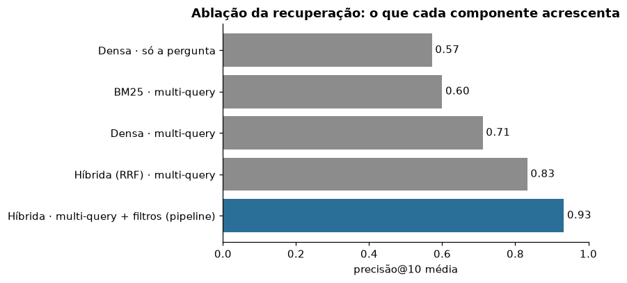

# Avaliação do pipeline RAG

Gerado em 16/11/2026 22:29 · LLM: `gpt-4o-mini` · embeddings: `sentence-transformers/paraphrase-multilingual-MiniLM-L12-v2` · top_k=15

## 0. Cobertura das perguntas do enunciado

Todas as perguntas citadas no enunciado do Tech Challenge, com a redação original.

| ID | Origem | Pergunta | Resultado | Evidências | Confiança |
|---|---|---|---|---|---|
| q01 | perguntas de negócio | Quais são os principais problemas relatados pelos clientes? | respondida | 12 | alta |
| q02 | perguntas de negócio | Quais reclamações relacionadas à entrega aparecem com maior frequência? | respondida | 15 | alta |
| q03 | perguntas de negócio | O que os clientes mais elogiam em suas experiências de compra? | respondida | 13 | alta |
| q04 | perguntas de negócio | Quais problemas são relatados por clientes insatisfeitos? | respondida | 12 | alta |
| q05 | perguntas de negócio | Existem padrões recorrentes nas avaliações relacionadas à qualidade dos produtos? | respondida | 9 | alta |
| q06 | exemplos de exploração | Quais são os principais problemas relatados pelos clientes em suas avaliações? | respondida | 12 | alta |
| q07 | exemplos de exploração | O que os clientes relatam sobre problemas relacionados à entrega? | respondida | 14 | alta |
| q08 | exemplos de exploração | Quais aspectos da experiência de compra são mais elogiados pelos clientes? | respondida | 9 | alta |
| q09 | exemplos de exploração | Quais padrões podem ser identificados nas avaliações de clientes insatisfeitos? | respondida | 15 | alta |
| q10 | exemplos de exploração | Quais avaliações sustentam a conclusão de que existem problemas recorrentes relacionados ao prazo de entrega? | respondida | 15 | alta |
| q11 | desafio adicional (metadados) | Quais são os principais problemas relatados nas avaliações com nota baixa? | respondida | 12 | alta |
| q12 | desafio adicional (metadados) | O que os clientes mais elogiam nos produtos de cama, mesa e banho? | respondida | 9 | alta |
| q13 | desafio adicional (metadados) | Quais temas aparecem nas avaliações de pedidos entregues com atraso? | respondida | 15 | alta |

## 1. Ablação da recuperação (precisão@10, relevância fraca por tema/metadado)

Multi-query = pergunta original + consultas reescritas pelo LLM no estilo do cliente.

| Pergunta | Densa · só a pergunta | BM25 · multi-query | Densa · multi-query | Híbrida (RRF) · multi-query | Híbrida · multi-query + filtros (pipeline) |
|---|---|---|---|---|---|
| q01 Quais são os principais problemas relatados pelos clien | 0.50 | 0.20 | 0.80 | 0.90 | 0.90 |
| q02 Quais reclamações relacionadas à entrega aparecem com m | 0.40 | 0.70 | 0.70 | 1.00 | 1.00 |
| q03 O que os clientes mais elogiam em suas experiências de  | 1.00 | 1.00 | 1.00 | 1.00 | 1.00 |
| q04 Quais problemas são relatados por clientes insatisfeito | 1.00 | 0.30 | 0.90 | 0.80 | 1.00 |
| q05 Existem padrões recorrentes nas avaliações relacionadas | 0.90 | 1.00 | 1.00 | 1.00 | 1.00 |
| q06 Quais são os principais problemas relatados pelos clien | 0.60 | 0.20 | 0.70 | 0.90 | 0.90 |
| q07 O que os clientes relatam sobre problemas relacionados  | 0.30 | 0.20 | 0.70 | 0.40 | 0.40 |
| q08 Quais aspectos da experiência de compra são mais elogia | 1.00 | 1.00 | 1.00 | 1.00 | 1.00 |
| q09 Quais padrões podem ser identificados nas avaliações de | 0.60 | 0.70 | 0.70 | 1.00 | 1.00 |
| q10 Quais avaliações sustentam a conclusão de que existem p | 0.80 | 0.50 | 0.90 | 1.00 | 1.00 |
| q11 Quais são os principais problemas relatados nas avaliaç | 0.70 | 0.80 | 0.70 | 0.90 | 1.00 |
| q12 O que os clientes mais elogiam nos produtos de cama, me | 0.20 | 0.30 | 0.20 | 0.70 | 1.00 |
| q13 Quais temas aparecem nas avaliações de pedidos entregue | 0.20 | 0.60 | 0.80 | 0.50 | 1.00 |
| q14 O que os clientes relatam sobre produtos que vieram dif | 0.90 | 0.70 | 0.60 | 1.00 | 1.00 |
| q15 Os clientes relatam pedidos incompletos ou itens faltan | 0.40 | 1.00 | 0.40 | 1.00 | 1.00 |
| q16 Como os clientes avaliam o atendimento e a comunicação  | 0.40 | 0.20 | 0.40 | 0.70 | 0.70 |
| q17 O que os clientes dizem sobre a embalagem dos produtos? | 0.10 | 0.90 | 0.90 | 0.90 | 0.90 |
| q18 Quais eram as principais reclamações dos clientes em 20 | 0.30 | 0.50 | 0.40 | 0.30 | 1.00 |
| **Média** | **0.572** | **0.6** | **0.711** | **0.833** | **0.933** |

## 2. Pipeline completo

| Métrica | Valor |
|---|---|
| Roteamento correto (geral) | 1 |
| Respondeu quando devia (in-scope) | 1 |
| Recusou quando devia (fora do escopo / sem evidência) | 1 |
| Filtros extraídos corretamente | 1 |
| Precisão@10 com multi-query + filtros do LLM | 0.933 |
| Citações inválidas (total) | 0 |
| Latência média (s) | 9.813 |
| Faithfulness média (LLM-as-a-judge) | 0.944 |
| Answer relevancy média (1-5) | 5 |

## 3. Detalhe por pergunta

| ID | Origem | Esperado | Status | Filtros | P@10 | Faithfulness | Relevância | Latência (s) |
|---|---|---|---|---|---|---|---|---|
| q01 | enunciado: perguntas de negócio | answered | answered | sem filtros | 0.90 | 1.00 | 5 | 17.07 |
| q02 | enunciado: perguntas de negócio | answered | answered | sem filtros | 1.00 | 1.00 | 5 | 9.86 |
| q03 | enunciado: perguntas de negócio | answered | answered | sem filtros | 1.00 | 1.00 | 5 | 9.26 |
| q04 | enunciado: perguntas de negócio | answered | answered | nota entre 1 e 2 | 1.00 | 1.00 | 5 | 32.46 |
| q05 | enunciado: perguntas de negócio | answered | answered | sem filtros | 1.00 | 1.00 | 5 | 9.16 |
| q06 | enunciado: exemplos de exploração | answered | answered | sem filtros | 0.90 | 1.00 | 5 | 14.63 |
| q07 | enunciado: exemplos de exploração | answered | answered | sem filtros | 0.40 | 0.50 | 5 | 9.67 |
| q08 | enunciado: exemplos de exploração | answered | answered | sem filtros | 1.00 | 1.00 | 5 | 9.65 |
| q09 | enunciado: exemplos de exploração | answered | answered | nota entre 1 e 2 | 1.00 | 1.00 | 5 | 30.96 |
| q10 | enunciado: exemplos de exploração | answered | answered | entrega: atrasado | 1.00 | 1.00 | 5 | 9.0 |
| q11 | enunciado: desafio adicional (metadados) | answered | answered | nota entre 1 e 2 | 1.00 | 0.50 | 5 | 9.26 |
| q12 | enunciado: desafio adicional (metadados) | answered | answered | categorias: bed_bath_table | 1.00 | 1.00 | 5 | 10.94 |
| q13 | enunciado: desafio adicional (metadados) | answered | answered | entrega: atrasado | 1.00 | 1.00 | 5 | 9.41 |
| q14 | complementar: tema específico | answered | answered | sem filtros | 1.00 | 1.00 | 5 | 8.99 |
| q15 | complementar: tema específico | answered | answered | sem filtros | 1.00 | 1.00 | 5 | 7.37 |
| q16 | complementar: tema específico | answered | answered | sem filtros | 0.70 | 1.00 | 5 | 9.31 |
| q17 | complementar: tema específico | answered | answered | sem filtros | 0.90 | 1.00 | 5 | 8.94 |
| q18 | complementar: período (metadado) | answered | answered | compras de 2017 a 2017 | 1.00 | 1.00 | 5 | 13.11 |
| q19 | requisito 4: fora do escopo | refused | out_of_scope | sem filtros | - | - | - | 1.46 |
| q20 | requisito 4: fora do escopo | refused | out_of_scope | sem filtros | - | - | - | 1.53 |
| q21 | requisito 4: fora do escopo | refused | out_of_scope | sem filtros | - | - | - | 1.4 |
| q22 | requisito 4: fora do escopo | refused | out_of_scope | sem filtros | - | - | - | 1.41 |
| q23 | requisito 4: sem avaliações relevantes | refused | insufficient_evidence | sem filtros | - | - | - | 4.69 |
| q24 | requisito 4: evidências insuficientes | refused | insufficient_evidence | sem filtros | - | - | - | 3.91 |
| q25 | requisito 4: evidências insuficientes | refused | out_of_scope | sem filtros | - | - | - | 1.87 |

### Afirmações não sustentadas apontadas pelo juiz

- q07: Os clientes frequentemente mencionam atrasos significativos na entrega dos produtos.
- q07: Um número considerável de clientes relata que seus pedidos não foram entregues.
- q11: Os clientes frequentemente relatam atrasos significativos na entrega dos produtos
- q11: Uma parte considerável dos clientes menciona que não recebeu o produto
- q11: Vários relatos indicam que os produtos chegaram com defeitos ou não atendem às expectativas de qualidade
