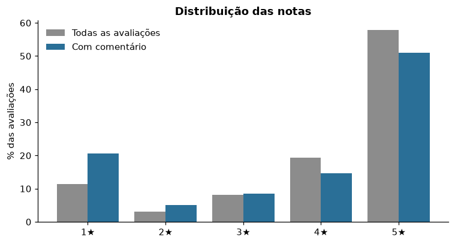
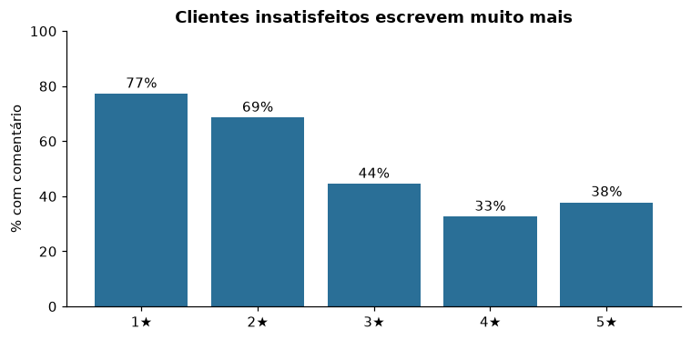
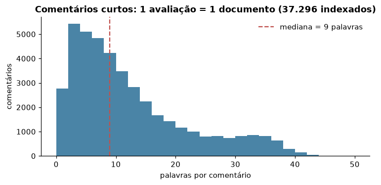
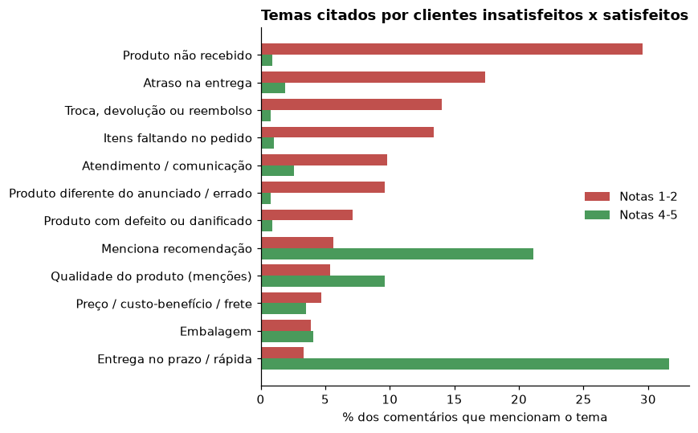
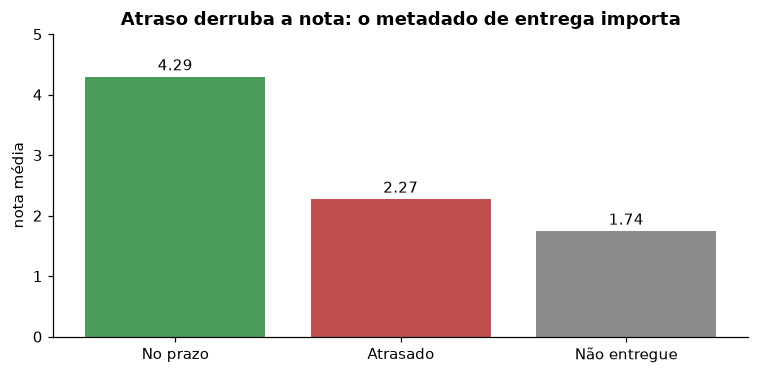
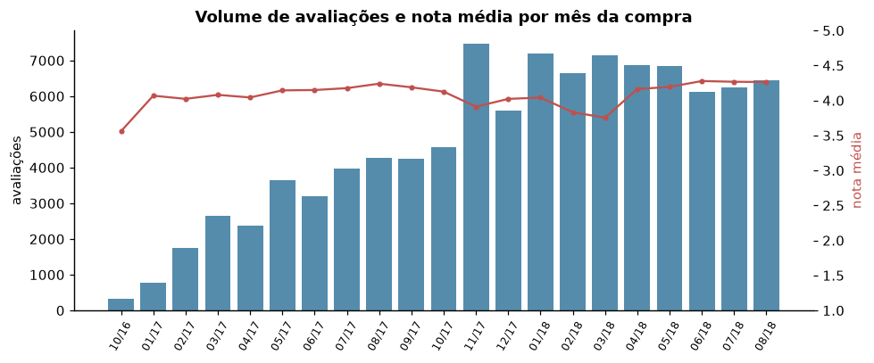
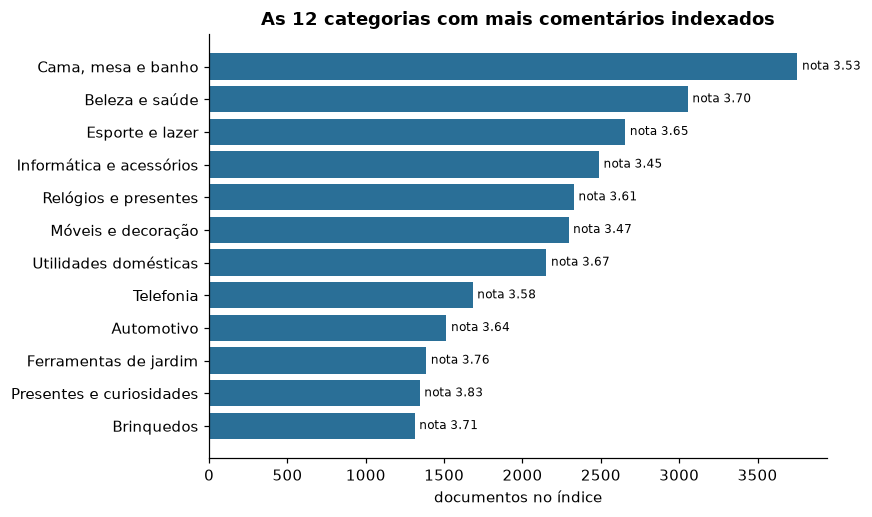

# Análise Exploratória — Avaliações de clientes da Olist

Base: **98.410 avaliações únicas** (camada Silver), de pedidos feitos entre 2016 e 2018.
**42.138** têm algum comentário (42.8%) e **37.296**
foram selecionadas como documentos do RAG (camada Gold).

## 1. As notas

77.1% das avaliações têm nota 4 ou 5, e
14.6% têm nota 1 ou 2. Entre as avaliações **com comentário**, a
proporção de notas baixas sobe para 25.7%: quem escreve é, com mais
frequência, quem teve problema.

## 2. Valores ausentes: quem escreve comentário

Título e mensagem são opcionais. 57.2% das avaliações não têm nenhum texto.
A ausência não é aleatória: 77% dos clientes que deram nota 1 escreveram algo, contra
38% dos que deram nota 5.

**Decisão:** avaliações sem texto ficam fora do índice (não há o que recuperar), mas continuam na Silver e
entram nas estatísticas de nota e de entrega.

## 3. Tamanho dos comentários

Mediana de **9 palavras** e máximo de 48. Um comentário cabe
inteiro em qualquer janela de contexto e costuma tratar de um ou dois assuntos.

**Decisão:** sem chunking. Cada avaliação é um documento.

Há 5.983 comentários com menos de 3 palavras e muitos textos repetidos. Os mais
frequentes são "muito bom" (547x), "recomendo" (416x) e
"bom" (401x).

**Decisão:** entram no índice apenas comentários com >= 3 palavras **ou** que mencionem
algum tema de negócio ("faltou produto" fica; "muito bom" sai). Comentários idênticos são agrupados na
recuperação.

## 4. Temas: o que os clientes contam

Percentual dos comentários que mencionam cada tema, por regras de palavras-chave. Um comentário pode ter
mais de um tema, e 37% não mencionam nenhum.

| Tema | Notas 1-2 (%) | Notas 4-5 (%) |
|---|---:|---:|
| Produto não recebido | 29.6 | 0.9 |
| Atraso na entrega | 17.4 | 1.9 |
| Troca, devolução ou reembolso | 14.0 | 0.8 |
| Itens faltando no pedido | 13.4 | 1.0 |
| Atendimento / comunicação | 9.8 | 2.6 |
| Produto diferente do anunciado / errado | 9.6 | 0.8 |
| Produto com defeito ou danificado | 7.1 | 0.9 |
| Menciona recomendação | 5.6 | 21.1 |
| Qualidade do produto (menções) | 5.4 | 9.6 |
| Preço / custo-benefício / frete | 4.7 | 3.5 |
| Embalagem | 3.9 | 4.1 |
| Entrega no prazo / rápida | 3.3 | 31.6 |

Entre insatisfeitos, os temas mais citados são **produto não recebido** (29.6%),
**atraso na entrega** (17.4%) e **troca, devolução ou reembolso** (14.0%).
Entre satisfeitos, **entrega no prazo / rápida** (31.6%) lidera com folga: a entrega é o tema
central da experiência, para o bem e para o mal.

**Decisão:** essas frequências, calculadas sobre o recorte inteiro, são enviadas ao LLM junto com as
evidências. O top-k recuperado é uma amostra e não mede frequência.

## 5. Entrega e satisfação

| Status da entrega | Nota média |
|---|---:|
| No prazo | 4.29 |
| Atrasado | 2.27 |
| Não entregue | 1.74 |

Pedidos atrasados têm nota média 2.0 pontos menor
que os entregues no prazo.

**Decisão:** o status de entrega (data real × estimada) vira metadado filtrável. Assim, "o que dizem os
clientes com entrega atrasada?" funciona mesmo quando o cliente não escreveu "atraso".

## 6. Período e categorias

As quedas de nota acompanham os atrasos. Os três meses com maior proporção de pedidos atrasados
(11/2017: 11.9% de atrasos e nota 3.91, 02/2018: 13.6% de atrasos e nota 3.83, 03/2018: 18.1% de atrasos e nota 3.75) estão entre os de pior nota média, enquanto a média dos demais meses fica em
3.8% de atrasos. Isso reforça o período da compra como metadado útil (o pipeline filtra
por ano, como em "quais eram as principais reclamações em 2017?").

As 74 categorias têm volumes muito diferentes, e perguntas sobre uma
categoria específica precisam de filtro: sem ele, a busca semântica traz comentários de qualquer produto
(ver a ablação em `reports/avaliacao.md`).
